<!-- _class: lead -->

# Computer Graphics

## 第4回： アニメーションの基礎 I

情報学部 情報学科 情報メディア専攻
清水 哲也

---

# 今日の内容

1. [アニメーションと時間](#sec-animation)
2. [`setup()` と `draw()`](#sec-processing)
3. [フレームと離散時間](#sec-frame)
4. [位置と速度によるアニメーション](#sec-motion)
5. [画面端の処理](#sec-boundary)
6. [ランダムなアニメーション](#sec-random)
7. [パラメータを変化させるアニメーション](#sec-parameter)
8. [演習](#sec-exercise)

---

<a id="sec-animation"></a>

<!-- _class: lead -->

# 1．Animation

## アニメーションと時間

---

# 静止画からアニメーションへ

これまでのプログラムでは，**1枚の静止画** を描いていました．

アニメーションでは，

> 時間の経過に応じて  
> 少しずつ異なる画像を連続して表示する

必要があります．

---

# アニメーションとは

アニメーションは，

**静止画の連続**

として考えることができます．

```text
Frame 0 → Frame 1 → Frame 2 → Frame 3 → …
```

各Frameでは少しずつ図形の状態が変化します．

---

# アニメーションとは

| frame 0 | frame 1 | frame 2 | frame 3 | frame 4 | frame 5 |
|---|---|---|---|---|---|
| 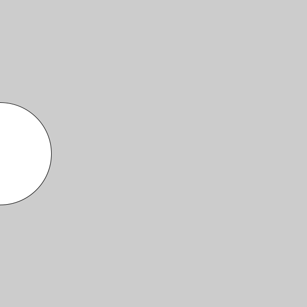 | 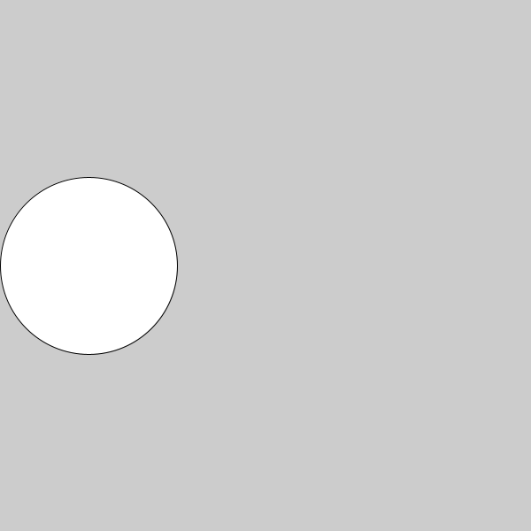 | 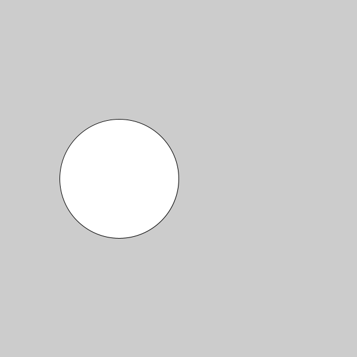 | 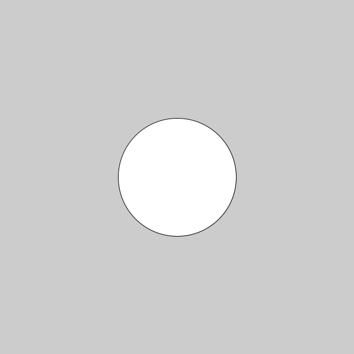 | 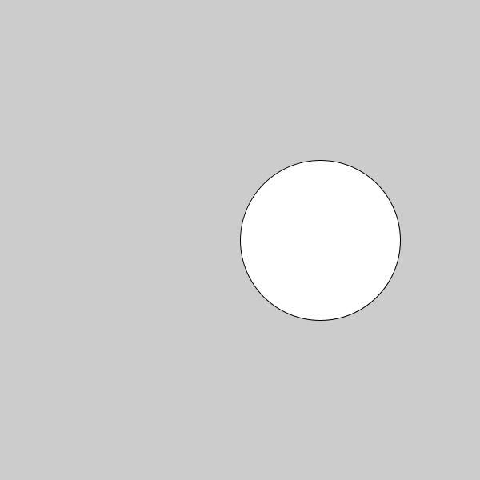 | 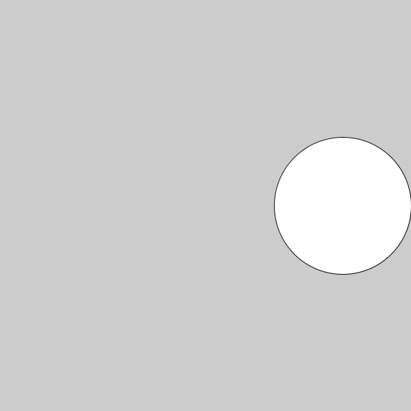 |

---

# パラパラ漫画

アニメーションの基本的な考え方は，**パラパラ漫画**と同じです．

1枚ごとの画像は静止していますが，

短い時間間隔で連続して表示すると  動いているように見えます．

---

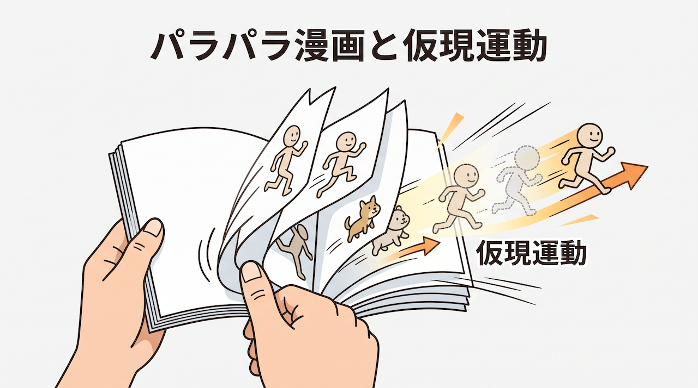

---

# 時間という新しい要素

静止画では，

$$
(x,y)
$$

だけで図形の位置を表せます．

アニメーションでは，位置が時間によって変化するので，

$$
x=x(t)
$$

$$
y=y(t)
$$

と考えます．

---

# 時間の関数としての位置

例えば，右方向へ一定速度で移動する物体は，以下のように表せます．

$$
x(t)=x_0+vt
$$
ここで，

- $x_0$：初期位置
- $v$：速度
- $t$：時間

です．

CGアニメーションでは，この数式をプログラムとして実装します．

---

# Animation = State + Time

アニメーションでは，

```text
現在の状態
    ↓
時間を進める
    ↓
状態を更新
    ↓
描画
```

を繰り返します．

つまり，**状態の更新**が重要です．

---

<a id="sec-processing"></a>

<!-- _class: lead -->

# 2．Processing

## `setup()` と `draw()`

---

# Processingの時間構造

Processingでは，

```processing
void setup() {

}
```

と

```processing
void draw() {

}
```

を使ってアニメーションを作ります．

---

# `setup()`

```processing
void setup() {
  size(600, 400);
}
```

`setup()` は，**プログラム開始時に1回だけ**実行されます．

主に，

- 画面サイズ
- 初期値
- 描画モード
- フレームレート

などを設定します．

---

# `draw()`

```processing
void draw() {

}
```

`draw()` は，**プログラムが動作している間，繰り返し実行**されます．

この繰り返しによってアニメーションを作ります．

---

# 実行の流れ

```text
START
  ↓
setup()
  ↓
draw()
  ↓
draw()
  ↓
draw()
  ↓
  …
```

`setup()` は1回，`draw()` は繰り返し実行されます．

---

# 実行の流れ

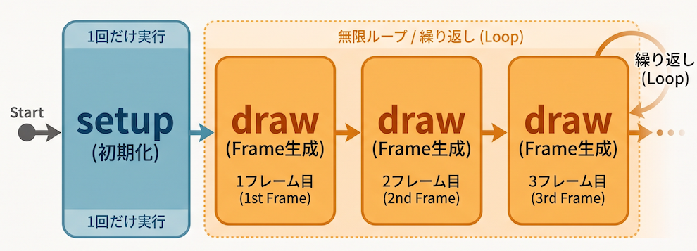

---

# 1回の`draw()` = 1 Frame

`draw()` が1回実行されるたびに，

**1枚のFrame**

が生成されると考えることができます．

```text
draw() → Frame 0
draw() → Frame 1
draw() → Frame 2
draw() → Frame 3
```

---

# 描画の基本構造

アニメーションでは一般に，

```processing
void draw() {

  background(...);

  // 図形を描く
  ellipse(...);

  // 状態を更新する
  x = x + 1;
}
```

という処理を繰り返します．

---

# なぜbackground()を書くのか

例えば，

```processing
background(255);
ellipse(x, 150, 50, 50);
```

とすると，

各Frameで画面を一度消してから新しい位置に円を描きます．

---

# background()がない場合

`background()` を書かないと，過去のFrameの描画結果が残ります．

そのため，**軌跡**のような表現になります．

| backgroundあり | backgroundなし |
|---|---|
|  | 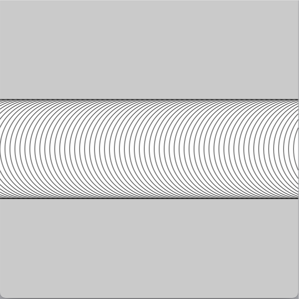 |

---

# 描画と更新の順序

```processing
ellipse(x, 150, 50, 50);

x = x + 1;
```

では，

1. 現在の $x$ で描画
2. $x$ を更新

します．

つまり，$x_n$を描画したあと，$x_{n+1}$を計算します．

---

<a id="sec-frame"></a>

<!-- _class: lead -->

# 3．Frame & Time

## フレームと離散時間

---

# Frame

アニメーションを構成する  
静止画1枚を**Frame**と呼びます．

Frame番号を

$$
n=0,1,2,3,\ldots
$$

とします．

---

# Frame Rate

1秒間に表示するFrame数を**Frame Rate**と呼びます．

単位は

$$
\mathrm{fps}
$$

です．

fps = frames per second

---

# 60 fps

60 fpsの場合，

1秒間に $60$ Frame表示します．

したがって，Frame間の時間は

$$
\Delta t=\frac{1}{60}
$$

秒です．

約 $16.7\ \mathrm{ms}$です．

---

# Frame Rateと時間間隔

Frame Rateを$f$とすると，Frame間隔は以下の式で表せます．

$$
\Delta t=\frac{1}{f}
$$

| fps  | $\Delta t$ |
| ---: | ---------: |
|   10 |      0.1 s |
|   30 |   0.0333 s |
|   60 |   0.0167 s |
|  120 |  0.00833 s |

---

# Processingの`frameRate()`

```processing
void setup() {
  size(600, 400);
  frameRate(30);
}
```

`frameRate()` を使って，目標Frame Rateを指定できます．

```processing
frameRate(30);
```

なら，約30fpsを目標にします．
デフォルトは，60fpsに設定されています．

---

# 離散時間

実際の時間 $t$ は連続量ですが，コンピュータアニメーションでは

$$
t_0,t_1,t_2,\ldots
$$

という離散的な時間として扱います．

---

# 時刻とFrame番号

Frame間隔が一定なら，$t_n=n\Delta t$です．

60 fpsなら，

$$
t_n=\frac{n}{60}
$$

となります．

例えば60 Frame後($n=60$)は，

$$
t_{60}=1
$$

秒です．

---

# 連続時間と離散時間

### 連続時間

$$
x(t)=x_0+vt
$$

### 離散時間

$$
x_n
$$

$$
x_{n+1}=x_n+\Delta x
$$

CGアニメーションでは，後者を繰り返し計算します．

---

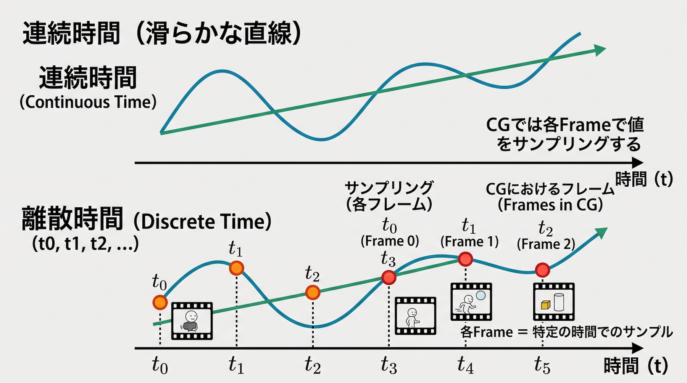

---

<a id="sec-motion"></a>

<!-- _class: lead -->

# 4．Motion

## 位置と速度によるアニメーション

---

# 最も単純な移動

```processing
float x = 0;

void draw() {

  background(255);

  ellipse(x, 150, 50, 50);

  x = x + 1;
}
```

各Frameで，

$$
x\leftarrow x+1
$$

と更新しています．

---

# 漸化式として表す

このプログラムは，

$$
x_{n+1}=x_n+1
$$

という**漸化式**です．

初期値を

$$
x_0=0
$$

とすると，

$$
x_n=n
$$

となります．

---

# 位置の時間変化

Frame番号 $n$ に対して，

$$
x_n=x_0+n\Delta x
$$

です．

これはFrame番号に対する**一次関数**です．

---

# $x-n$グラフ

$$
x_n=x_0+n\Delta x
$$

では，$x$ は一定量ずつ増加します．

グラフにすると直線になります．

傾きは，

$$
\Delta x
$$

です．

---

# 例題1｜右方向への移動

```processing
float x = 0;

void setup() {
  size(400, 300);
}

void draw() {

  background(255);

  ellipse(x, 150, 100, 100);

  x = x + 1;
}
```

円が左から右へ移動します．

---

# 速度を変数にする

```processing
float x = 0;
float xSpeed = 2;

void draw() {

  background(255);

  ellipse(x, 150, 50, 50);

  x = x + xSpeed;
}
```

これで移動量を変数として制御できます．

---

# 速度と位置

1 Frameあたりの移動量を

$$
v
$$

とすると，

$$
x_{n+1}=x_n+v
$$

です．

したがって，

$$
x_n=x_0+nv
$$

となります．

---

# pixel / frame

ここでの `xSpeed` は厳密には，

$$
\mathrm{pixel/frame}
$$

です．

例えば，

```processing
xSpeed = 2;
```

なら，

1 Frameで2 pixel移動します．

---

# fpsを考える

Frame Rateを $f$ とすると，

1秒間の移動距離は

$$
v_{\mathrm{sec}}
=
v_{\mathrm{frame}}\times f
$$

です．

例えば，

$$
2\ \mathrm{pixel/frame}
$$

で60 fpsなら，

$$
120\ \mathrm{pixel/s}
$$

です．

---

<!-- _class: no-footer -->

# Frame Rateによる違い

同じ

```processing
x = x + 2;
```

でも，

### 30 fps

$$
60\ \mathrm{pixel/s}
$$

### 60 fps

$$
120\ \mathrm{pixel/s}
$$

となります．

つまり，Frame単位の更新ではfpsによって見かけの速度が変化します．

---

# 時間を使った更新

物理的な速度を

$$
v\ [\mathrm{pixel/s}]
$$

とすると，

$$
x_{n+1}
=
x_n+v\Delta t
$$

と更新できます．

これは後の物理アニメーションでも重要な考え方です．

---

# 離散化

連続時間では，

$$
\frac{dx}{dt}=v
$$

です．

これをFrame単位に近似すると，

$$
\frac{x_{n+1}-x_n}{\Delta t}
\approx v
$$

したがって，

$$
x_{n+1}=x_n+v\Delta t
$$

となります．

---


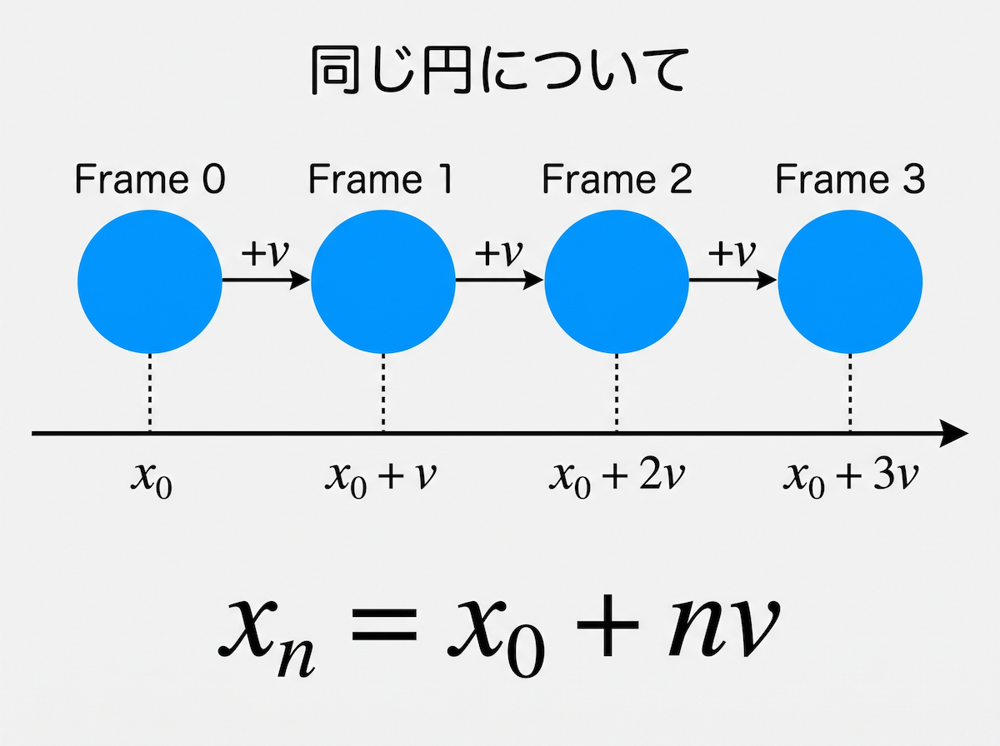

---

<a id="sec-boundary"></a>

<!-- _class: lead -->

# 5．Boundary

## 画面端の処理

---

# 画面外へ出る

単純に

```processing
x = x + xSpeed;
```

とすると，円は最終的に画面外へ出てしまいます．

そこで，条件分岐を使います．

---

# 右端でリセットする

```processing
if (x > width) {
  x = 0;
}
```

これは，

$$
x>W
$$

ならば

$$
x\leftarrow0
$$

とする処理です．

---

# Piecewise Function

数学的には，

$$
x_{n+1}
=
\begin{cases}
x_n+v & x_n+v\leq W\\
0 & x_n+v>W
\end{cases}
$$

という**区分関数**として考えられます．

---

# 周期的な空間として見る

右端を超えると左端に戻る動きは，

```text
0 ───────────── W
↑               │
└───────────────┘
```

のように，

右端と左端が接続した空間

と考えることもできます．

---

# moduloによる表現

数学的には，

$$
x_{n+1} = (x_n+v)\bmod W
$$

と書くことができます．

Processingでは，

```processing
x = (x + xSpeed) % width;
```

のような表現も可能です．

---

# 正方向・負方向

速度

$$
v>0
$$

なら右方向，

$$
v<0
$$

なら左方向へ移動します．

つまり，速度の**符号**が移動方向を表します．

---

# 例題2｜方向を含む移動

```processing
float x;
float y;
float xSpeed;

void setup() {

  size(600, 480);

  noStroke();
  fill(0, 0, 255);

  x = random(width);
  y = height / 2;

  xSpeed = random(-10, 10);
}
```

---

# 移動とリセット

```processing
void draw() {

  background(255);

  ellipse(x, y, 40, 40);

  x = x + xSpeed;

  if (x > width) {
    x = 0;
  }

  if (x < 0) {
    x = width;
  }
}
```

---

# 状態遷移として考える

1 Frameごとに，$x_n$から$x_{n+1}$へ状態が変化します．

```text
x_n
 ↓
移動
 ↓
境界判定
 ↓
x_(n+1)
```

これを**状態遷移**と考えることができます．

---

<!-- _class: no-header no-footer -->

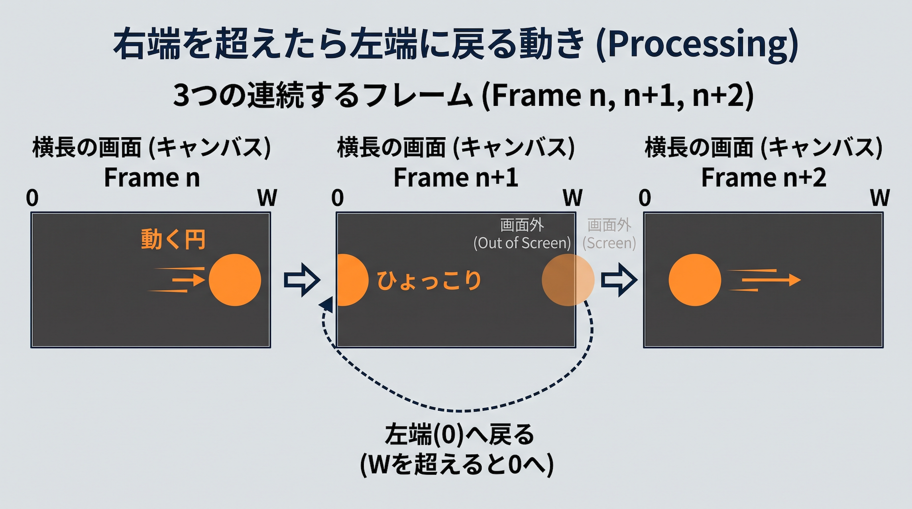

---

<a id="sec-random"></a>

<!-- _class: lead -->

# 6．Randomness

## ランダムなアニメーション

---

# `random()`

Processingでは，

```processing
random(a, b);
```

を使って，

$$
a\leq X<b
$$

の範囲の乱数を生成できます．

---

# 確率変数として考える

```processing
float x = random(width);
```

は，

$$
X\sim U(0,W)
$$

と考えることができます．

$U$ は**一様分布**を表します．

---

# 2次元のランダム位置

```processing
float x = random(width);
float y = random(height);
```

では，

$$
X\sim U(0,W)
$$

$$
Y\sim U(0,H)
$$

となります．

画面内のランダムな位置

$$
(X,Y)
$$

を生成しています．

---


# 例題3｜ランダムな位置と色

```processing
void setup() {

  size(400, 400);

  noStroke();
  background(0);
}

void draw() {

  fill(random(256), random(256), random(256));

  ellipse(random(width), random(height), 50, 50);
}
```

---

# 色も確率変数

RGB値について，

$$
R\sim U(0,256)
$$

$$
G\sim U(0,256)
$$

$$
B\sim U(0,256)
$$

とすると，

毎Frame異なる色を生成できます．

---

# `background()`を書かない

この例では `draw()` 内で

```processing
background(0);
```

を実行しないため，過去の円が画面に残ります．

Frameを重ねることで，**時間的な蓄積**が生まれます．

---

# Frameごとの確率過程

Frame $n$ ごとに，

$$
X_n,\ Y_n,\ R_n,\ G_n,\ B_n
$$

を新しく生成します．

つまり，

アニメーション全体を**確率的な時系列**として考えることもできます．

---

# Frameごとの確率過程

| Frame = 1 | Frame = 10 | Frame = 100|
|---|---|---|
| 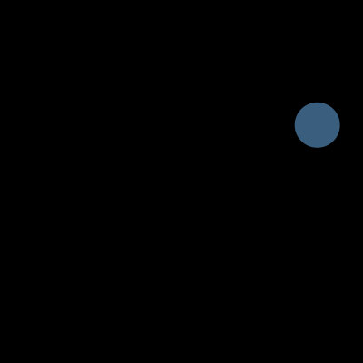 | 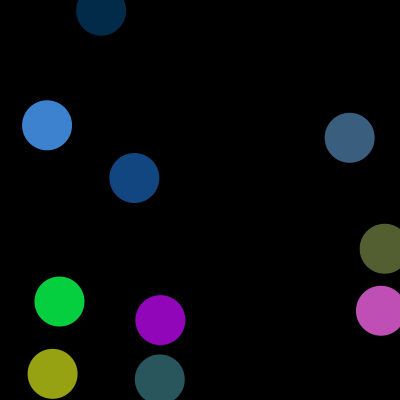 | 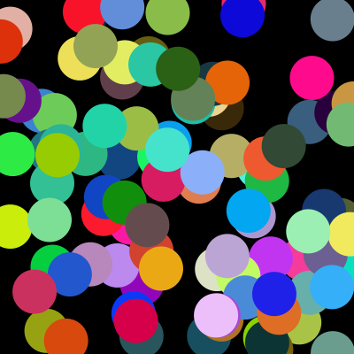 |

---

<a id="sec-parameter"></a>

<!-- _class: lead -->

# 7．Parameter Animation

## パラメータを変化させる

---

# 動かすのは位置だけではない

アニメーションでは，位置だけでなく，

- 大きさ
- 色
- 角度
- 透明度
- 形状

なども時間によって変化させられます．

---

# 円のサイズを変える

円の直径を$r_n$とすると，

```processing
ringSize = ringSize + 2;
```

は，

$$
r_{n+1}=r_n+2
$$

という漸化式です．

---

# 線形増加

初期値を

$$
r_0=1
$$

とすると，

$$
r_n=1+2n
$$

です．

つまり，Frame番号に対して円の大きさが線形に増加します．

---

# 例題4｜波紋

```processing
float x, y;
float ringSize;

void setup() {

  size(500, 500);

  noFill();
  smooth();

  stroke(255, 0, 0);

  x = random(50, width - 50);
  y = random(50, height - 50);

  ringSize = 1;
}
```

---

# 波紋の更新

```processing
void draw() {

  background(255);

  ellipse(x, y, ringSize, ringSize);

  ringSize = ringSize + 2;

  if (ringSize > 300) {

    x = random(width);
    y = random(height);

    ringSize = 1;
  }
}
```

---

# 数学的モデル

波紋サイズは，数学的に以下のように表せます．

$$
r_{n+1}
=
\begin{cases}
r_n+2 & r_n\leq300\\
1 & r_n>300
\end{cases}
$$

これは，

**増加 → 閾値判定 → リセット**

というモデルです．

---

# Threshold

条件

$$
r>300
$$

の300を **Threshold（閾値）** と呼びます．

多くのCGアルゴリズムでは，ある値が閾値を超えたときに状態を変更します．

---

# 周期

1 Frameにつき2 pixel増える場合，

約

$$
\frac{300-1}{2}
\approx150
$$

Frameでリセットされます．

60 fpsなら，

$$
\frac{150}{60}
=2.5
$$

秒程度です．

---

# 波紋

| Frame = 1 | Frame = 30 | Frame = 60 | Frame = 90 |
|---|---|---|---|
| 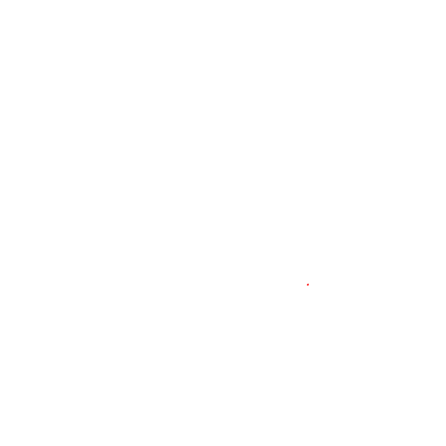 | 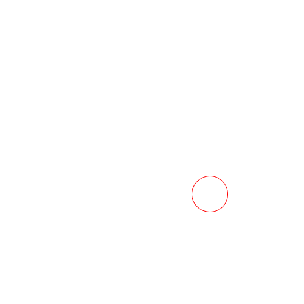 | 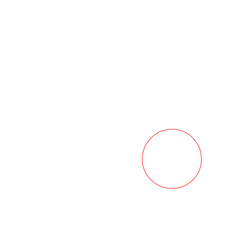 | 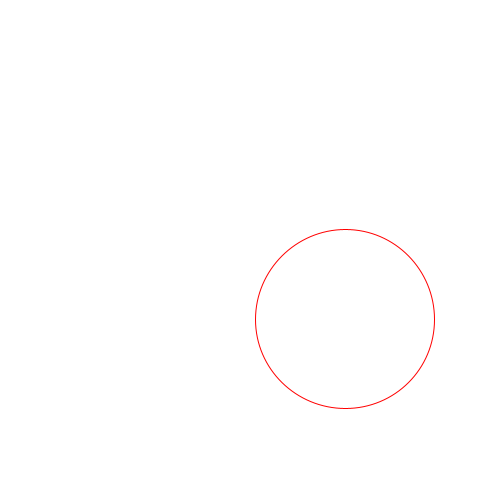 |

$$
r_n = r_0 + 2n
$$

---

# 位置以外の時間変化

例えば色相を，

$$
H_{n+1}=H_n+\Delta H
$$

と更新すれば，

時間とともに色を変化させられます．

```processing
h = h + 1;
fill(h % 360, 80, 100);
```

---

# 正弦波を使った変化

周期的な変化には，

$$
y(t)=A\sin(\omega t+\phi)
$$

を利用できます．

Frame番号を使うなら，

$$
y_n
=
A\sin(\omega n+\phi)
$$

です．

この考え方は今後のアニメーション表現で利用できます．

---

# なめらかな往復運動

```processing
float y =
  height / 2
  + 100 * sin(frameCount * 0.05);
```

これにより円が上下に滑らかに往復します．

---

# 数学とアニメーション

時間変化を数式で記述すると，

```text
線形関数 → 一定速度

sin / cos → 周期運動

指数関数 → 急激な増減

乱数 → 不規則な変化
```

のように，数式そのものが動きのデザインになります．

---

<a id="sec-exercise"></a>

<!-- _class: lead -->

# 8．Exercise

## 演習

---

# 演習1｜一定速度

次の条件で円を移動させてください．

- 画面サイズ：$600\times300$
- 円の直径：50
- 初期位置：$(0,150)$
- 速度：3 pixel/frame

位置は，

$$
x_{n+1}=x_n+3
$$

としてください．

---

# 演習2｜速度を変更する

演習1について，

```processing
float xSpeed
```

を導入してください．

次の値を試します．

$$
xSpeed=1
$$

$$
xSpeed=5
$$

$$
xSpeed=-3
$$

移動速度と方向を確認してください．

---

# 演習3｜画面端でリセット

円が右端へ到達したら，

左端へ戻してください．

$$
x>width
$$

の条件を利用します．

発展：

円全体が画面外へ出てから  
リセットするようにしてください．

---

# 演習4｜周期運動

`sin()` を使って，

円を上下に往復させてください．

$$
y_n
=
\frac{height}{2}
+
A\sin(\omega n)
$$

### パラメータ

- $A$：振幅
- $\omega$：変化の速さ

---

# 演習5｜波紋

波紋の例題を改造してください．

### 条件

- 波紋を3本同時に表示する
- 大きさを異なる速度で変化させる
- 透明度も時間とともに変化させる

---

<!-- _class: lead -->

# Summary

## 今日のまとめ

---

# アニメーションの基本

アニメーションとは，

**状態を時間とともに更新して描画すること**

です．

```text
描画
 ↓
更新
 ↓
描画
 ↓
更新
 ↓
…
```

---

# 数学との対応

| Processing | 数学 |
|---|---|
| Frame | 離散時間 |
| `frameRate()` | 時間間隔 |
| `x = x + v` | 漸化式 |
| `xSpeed` | 速度 |
| `if` | 区分関数 |
| `random()` | 確率変数 |
| 波紋 | パラメータ変化 |
| `sin()` | 周期関数 |

---

# 今日の重要式

### Frame間隔

$$
\Delta t=\frac{1}{f}
$$

### 一定速度運動

$$
x_{n+1}=x_n+v
$$

### 時間を考慮した更新

$$
x_{n+1}=x_n+v\Delta t
$$

### 周期運動

$$
x_n=A\sin(\omega n+\phi)
$$

---

# アニメーションを設計する

アニメーションを考えるときは，

1. **何を変化させるか**
2. **どのような規則で変化させるか**
3. **いつ状態を変更するか**

を考えます．

---

# 次回

## アニメーションの基本 II

次回は，**座標変換**を扱います．

- `translate()`
- `rotate()`
- `scale()`
- `pushMatrix()`
- `popMatrix()`

図形そのものではなく，**座標系を変換して動かす**方法へ進みます．