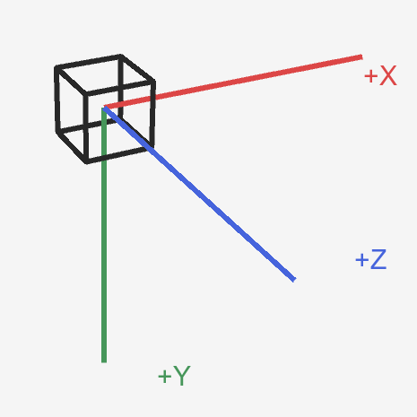
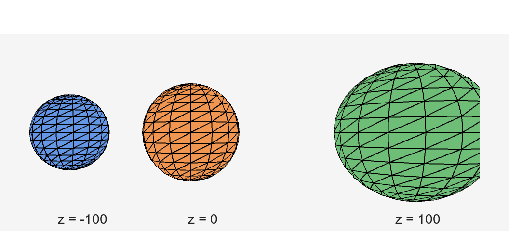
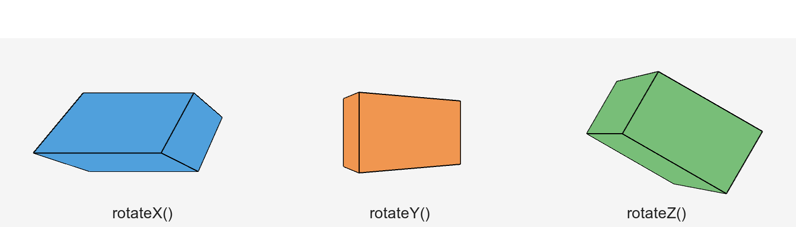
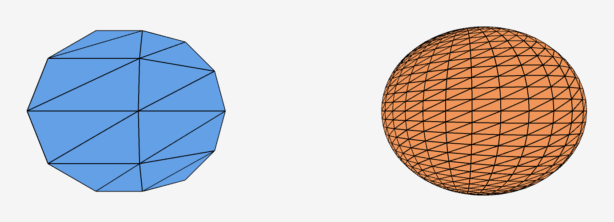

<!-- _class: lead -->

# Computer Graphics

## 第6回 : 3Dモデルの描画とアニメーション

情報学部 情報学科 情報メディア専攻  
清水 哲也

---

# 今日の内容

1. [2Dから3Dへ](#sec-introduction)
2. [P3Dと3次元座標系](#sec-coordinate)
3. [3次元の座標変換](#sec-transform)
4. [3Dモデルの基本図形](#sec-model)
5. [3Dアニメーション](#sec-animation)
6. [演習](#sec-exercise)
7. [まとめと次回](#sec-summary)

---

<a id="sec-introduction"></a>

<!-- _class: lead -->

# 1．Introduction

## 2Dから3Dへ

---

# 前回の復習｜2Dの座標変換

第5回では，図形を描く座標系を変換しました．

```processing
translate(x, y);
rotate(angle);
scale(s);
```

図形の形を直接変えるのではなく，その後に描く座標系を変えました．

---

# 2Dから3Dへ

扱う座標が1つ増えます．

```text
2D：x，y
        ↓
3D：x，y，z
```

- `x`：左右の位置
- `y`：上下の位置
- `z`：奥行きの位置

---

# 3DCGの考え方

> 3次元空間に配置された図形を，2次元の画面へ投影して表示する．

ディスプレイそのものは2次元です．

3D空間をそのまま表示しているのではなく，空間の情報を画面上の見え方へ変換しています．

今回は投影の数式よりも，3次元空間での座標変換とモデルの動きを考えます．

---

# 今回の見方

```text
3D空間の座標
      ↓  座標変換
3Dモデルの位置・向き
      ↓  画面への投影
2Dのディスプレイ
```

Processingのコードでは，この流れを意識して図形を描きます．

---

<a id="sec-coordinate"></a>

<!-- _class: lead -->

# 2．Coordinate System

## P3Dと3次元座標系

---

# `P3D`を指定する

Processingで3D描画を行うときは，`P3D`を指定します．

```processing
void setup() {
  size(600, 600, P3D);
}
```

`P3D`は，3D描画用のRendererを使用する指定です．

---

# 2D Rendererとの違い

```processing
size(600, 600);
```

通常は2D描画用のRendererが使われます．

```processing
size(600, 600, P3D);
```

`P3D`では，`z`座標を含む図形や座標変換を扱えます．

---

# Processingの3次元座標系

Processingでは次の向きを使います．

```text
+X：右
+Y：下
+Z：画面の手前側
```

2Dの画面座標に，奥行き方向の`z`軸が加わります．

---

# 軸を図形として確認する

座標軸も3D空間内の線として描けます．

```processing
translate(width / 2, height / 2);
rotateX(radians(-25));
rotateY(radians(25));
line(0, 0, 0, 180, 0, 0); // +X
line(0, 0, 0, 0, 180, 0); // +Y
line(0, 0, 0, 0, 0, 180); // +Z
```

`line()`の6つの値は，始点と終点の`x，y，z`です．

座標系を少し回転させることで，画面正面からは見えにくい`+Z`軸も確認できます．

実行例は`sample_06_01_p3d`で確認できます．

---

# 3次元座標系の実行例

`sample_06_01_p3d`では，原点から3本の軸を描いています．



赤が`+X`，緑が`+Y`，青が`+Z`です．

---

# 3Dでの原点

画面の中央を3D空間の原点にすると，モデルを中心に置きやすくなります．

```processing
translate(width / 2, height / 2);
```

この時点では，`z = 0`の位置へ座標系の原点を移動しています．

その後に描くモデルは，移動後の座標系を基準にします．

---

<a id="sec-transform"></a>

<!-- _class: lead -->

# 3．Transformations

## 3次元の座標変換

---

# 3次元の`translate()`

2Dでは2つの引数でした．

```processing
translate(200, 200);
```

3Dでは`z`を加えます．

```processing
translate(200, 200, 50);
```

`translate()`は，その後に描く座標系の原点を移動します．

---

# `z`を変えて位置を比べる

次の3つは同時に実行するコードではありません．それぞれ別々に実行し，見え方を比較します．

```processing
translate(width / 2, height / 2, 100);
```

```processing
translate(width / 2, height / 2, 0);
```

```processing
translate(width / 2, height / 2, -100);
```

`z`の値を1つずつ変えると，モデルの奥行き方向の位置が変わります．

---

# `z`の符号を確認する

```text
z < 0       z = 0       z > 0
奥側         基準         手前側
```

Processingでは，正の`z`方向が画面の手前側です．

実際の見え方は投影によって変化するため，値を変えて実行結果を観察します．

---

# Z値の比較結果

`sample_06_03_translate_z`では，3つの球を`z=-100`，`z=0`，`z=100`へ別々に配置しています．


---

# 3次元の回転

3Dでは，回転する軸を指定します．

```processing
rotateX(angle);
rotateY(angle);
rotateZ(angle);
```

- `rotateX()`：X軸周り
- `rotateY()`：Y軸周り
- `rotateZ()`：Z軸周り

---

# `rotateZ()`と2Dの`rotate()`

画面正面から見た回転では，`rotateZ()`が2Dの`rotate()`に対応します．

```processing
rotate(angle);    // 2D
rotateZ(angle);   // 3D
```

3Dでは，どの軸を中心に回すかを明示します．

---

# X軸周りの回転

```processing
rotateX(angle);
box(120);
```

X座標を保ったまま，Y-Z平面内で回転します．

箱の上面や下面の見え方が変化します．

---

# Y軸周りの回転

```processing
rotateY(angle);
box(120);
```

Y座標を保ったまま，X-Z平面内で回転します．

箱の左右の面の見え方が変化します．

---

# Z軸周りの回転

```processing
rotateZ(angle);
box(120);
```

Z軸を固定したまま，画面内のX方向とY方向が回転します．

2Dの`rotate()`と同じ向きの回転として観察できます．

---

# 3つの回転を実行例で比べる

同じ角度でも，固定する軸が違うと見え方が変わります．

```processing
rotateX(angle);
rotateY(angle);
rotateZ(angle);
```

`sample_06_02_rotate_xyz`では，3つのモデルを並べて比較します．

まずは各回転を1つずつ変更して観察します．

---

# `rotateX()` / `rotateY()` / `rotateZ()`の比較



同じ立方体でも，回転軸が異なると見える面の変化が異なります．

---

# 回転を組み合わせる

複数の軸周りの回転も組み合わせられます．

```processing
rotateX(angle);
rotateY(angle * 1.2);
rotateZ(angle * 0.8);
```

第5回と同じく，座標変換の順序によって結果が変わります．

今回は順序の復習に留め，3Dモデルの見え方を観察します．

---

<a id="sec-model"></a>

<!-- _class: lead -->

# 4．3D Models

## 3Dモデルの基本図形

---

# `box()`｜立方体

```processing
box(120);
```

引数は一辺の長さです．

`box()`は，現在の座標系の原点を中心に描画されます．

---

# `box()`｜直方体

```processing
box(100, 150, 80);
```

引数は順に，幅，高さ，奥行きです．

```text
box(width，height，depth)
```

現在の座標系を移動・回転してから描画すると，モデルの位置と向きを整理できます．

---

# 座標変換と`box()`

```processing
translate(width / 2, height / 2);
rotateX(angle);
rotateY(angle);
box(120);
```

`box()`のコードは原点を中心に描くままです．

座標系を変換することで，画面中央の回転する立方体になります．

---

# `sphere()`｜球体

```processing
sphere(100);
```

引数は球の半径です．

球体も現在の座標系の原点を中心に描画されるため，`translate()`や`scale()`と組み合わせて使います．

球は対称性が高いため，回転だけでは見た目の変化を観察しにくいことがあります．位置，大きさ，分割数の変化も合わせて観察します．

---

# 球体も近似で描く

コンピュータグラフィックスでは，球面を無限に細かい曲面としてそのまま描くわけではありません．

多数の小さな面を組み合わせて，球らしい形を近似します．

この近似の細かさを変えるのが`sphereDetail()`です．

---

# `sphereDetail()`で分割数を変える

```processing
sphereDetail(6);
sphere(100);
```

```processing
sphereDetail(30);
sphere(100);
```

分割数が少ないと，多面体に近い見え方になります．

分割数が多いと，より滑らかな球に見えます．

---

# 見た目と計算量のバランス

分割数を増やすほど，球らしく見えます．

一方で，描画する面の数も増えるため，必要な処理が増えます．

```text
分割数を増やす
      ↓
見た目は滑らかになる
      ↓
描画に必要な処理も増える
```

これは，形状をどの細かさで近似するかというCGの考え方です．

---

# `sphereDetail()`を比較する

`sample_06_05_sphere`では，左は`sphereDetail(6)`，右は`sphereDetail(30)`とし，分割の細かさを比較しています．

```processing
sphereDetail(6);
sphere(90);
```

```processing
sphereDetail(30);
sphere(90);
```

分割数と見た目の関係を実行結果で確認します．

---

# `sphereDetail()`の比較結果



左は`sphereDetail(6)`，右は`sphereDetail(30)`です．

---

<a id="sec-animation"></a>

<!-- _class: lead -->

# 5．Animation

## 3Dモデルを動かす

---

# 第4回・第5回からの接続

アニメーションでは，状態を変数に持ち，Frameごとに更新します．

```text
状態
 ↓
描画
 ↓
更新
 ↓
次のFrame
```

3Dでも，位置や角度を状態として持つ考え方は変わりません．

---

# 回転角を状態として持つ

```processing
float angle = 0;

void draw() {
  background(240);

  translate(width / 2, height / 2);
  rotateX(angle);
  rotateY(angle * 1.2);
  box(150);

  angle += radians(1);
}
```

角度をFrameごとに更新すると，モデルが回転します．

---

# 回転アニメーションの対応

数学的には，角度を離散時間で更新しています．

```text
angle[n+1] = angle[n] + omega
```

Processingでは，次の対応になります．

```processing
angle += omega;
```

2Dで学んだ状態更新を，3Dの回転へ拡張しています．

---

# `pushMatrix()` / `popMatrix()`を再利用する

3Dでも，座標変換の範囲を分けられます．

```processing
pushMatrix();
translate(...);
rotateX(...);
rotateY(...);
box(...);
popMatrix();
```

第5回と同じく，別のモデルへ変換が影響しないように使います．

---

# Z方向へ移動する球体

球体の奥行き位置を状態として持ちます．

```processing
float z;
float speedZ;
```

描画では，現在の`z`を座標変換へ渡します．

```processing
pushMatrix();
translate(width / 2, height / 2, z);
sphere(30);
popMatrix();
```

---

# Z位置を更新する

```processing
z += speedZ;
```

これは，位置と速度を使った第4回の更新と同じ構造です．

```text
z[n+1] = z[n] + speedZ
```

3Dでは，更新する成分が`x`や`y`から`z`へ広がっています．

---

# Z方向の移動をリセットする

一定の位置を超えたら，最初の位置へ戻します．

```processing
z += speedZ;

if (z > 260) {
  z = -260;
}
```

奥から手前へ移動し，手前まで来たら再び奥から現れます．

---

# Z方向のアニメーション全体

```text
状態：z，speedZ，angle
  ↓
描画：translate(..., z)，rotateX()，rotateY()
  ↓
更新：z += speedZ，angle += omega
  ↓
条件判定：z > 260 なら z = -260
```

`sample_06_06_3d_animation`で確認できます．

---

# 乱数を補助に使う

乱数を使って，3D空間内の位置を生成できます．

```processing
float x = random(-200, 200);
float y = random(-150, 150);
float z = random(-300, 300);
```

今回の主題は乱数ではありません．

複数のモデルを異なる位置へ置くための補助として利用します．

---

# 今回扱わない内容

次の内容は，次回以降に扱います．

```text
lights()，ambientLight()，directionalLight()
pointLight()，spotLight()
ambient()，specular()，shininess()
texture()，PShape / OBJファイル
camera() の詳細，perspective() の詳細
```

---

# 次回への接続

今回のモデルは，単色で立体感が分かりにくい場合があります．

次回は，光と陰影を使って立体感を表現します．

```text
3Dモデルの形と動き
          ↓
光・陰影による見え方
```

今回は照明関数や材質の詳細には進みません．

---

<a id="sec-exercise"></a>

<!-- _class: lead -->

# 6．Exercise

## 3D座標変換とアニメーション

---

# 演習1｜回転軸を変える

`sample_06_02_rotate_xyz`を変更します．

- `rotateX()`を`rotateY()`へ変更する
- `rotateY()`を`rotateZ()`へ変更する
- 3つのモデルの回転角を変えて比較する

どの軸を固定して回転しているか，見え方と対応づけて説明してください．

---

<!-- _class: no-footer -->

# 演習2｜`box()`と`sphere()`を組み合わせる

1つのSketchに立方体と球体を描きます．

```processing
pushMatrix();
translate(width / 2, height / 2, 0);
translate(-100, 0, 0);
box(100);
popMatrix();
```

`pushMatrix()` / `popMatrix()`を使い，この立方体とは別に，右側へ球体を描いてください．

```processing
pushMatrix();
translate(width / 2, height / 2, 0);
translate(100, 0, 0);
sphere(50);
popMatrix();
```

---

# 演習3｜3Dアニメーション

少なくとも1つの3Dモデルについて，次のどちらかを時間変化させます．

- 回転
- Z方向の移動

余裕があれば，回転と移動を同時に行い，移動後に位置をリセットしてください．

授業で扱っていない高度な関数は必須にしません．

---

<a id="sec-summary"></a>

<!-- _class: lead -->

# 7．Summary

## まとめと次回

---

# 今日のまとめ｜3D描画

- `P3D`で3D描画を行う
- 3DではX・Y・Zの3軸を扱う
- `translate(x, y, z)`で3次元的に座標系を移動できる
- `rotateX()` / `rotateY()` / `rotateZ()`で各軸周りに回転できる

---

# 今日のまとめ｜3Dモデルと状態更新

- `box()`で直方体を描画できる
- `sphere()`で球体を描画できる
- `sphereDetail()`で球体の分割数を変更できる
- 第4・5回で学んだ状態更新・座標変換は3Dでも利用できる

---

# 3Dを理解する視点

```text
3D座標系
  ＋
座標変換
  ＋
モデルの形状
  ＋
Frameごとの状態更新
```

3Dモデルの使い方を覚えるだけでなく，空間・変換・投影・時間の関係を考えます．

---

# 次回｜3Dモデルと陰影表現

次回は，次の内容を扱います．

- 光
- 陰影
- 立体感

今回描いた3Dモデルに，光による見え方を加えます．

---

<!-- _class: lead -->

# 次回

## 3Dモデルと陰影表現

### 光を使って，形を見せる
