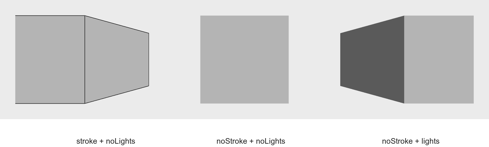
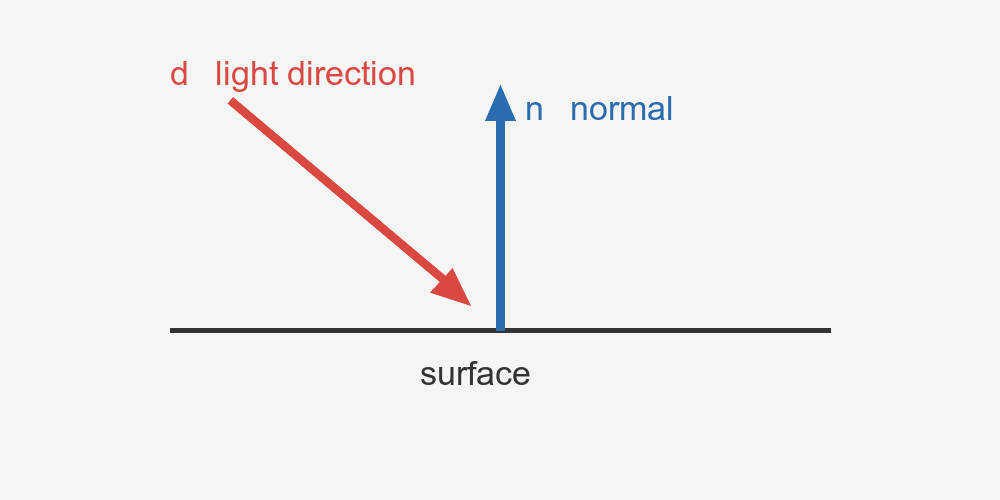
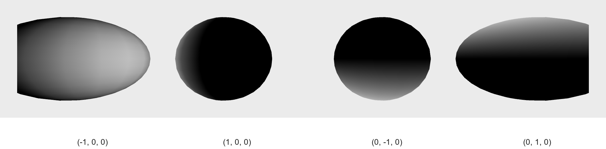
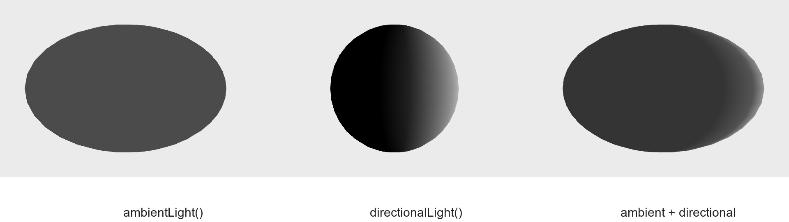
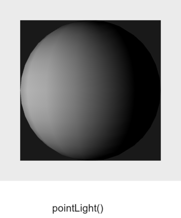
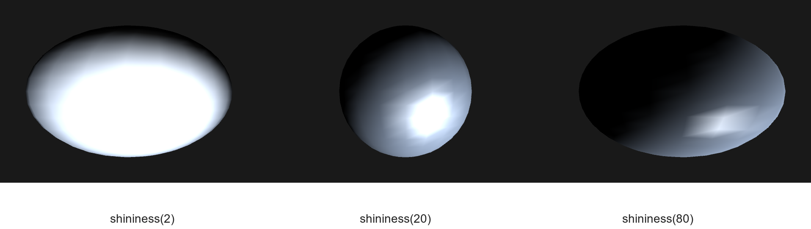

<!-- _class: lead -->

# Computer Graphics

## 第7回 : 陰影・照明

### 光を使って，3Dモデルの形を見せる

情報学部 情報学科 情報メディア専攻  
清水 哲也

---

# 今日の内容

1. [なぜ光が必要なのか](#sec-introduction)
2. [`lights()`と陰影](#sec-lights)
3. [光と面の向き](#sec-normal)
4. [4種類の光源](#sec-sources)
5. [材質とハイライト](#sec-material)
6. [照明付きアニメーション](#sec-animation)
7. [演習](#sec-exercise)
8. [まとめと次回](#sec-summary)

---

<a id="sec-introduction"></a>

<!-- _class: lead -->

# 1．Introduction

## なぜ光が必要なのか

---

# 第6回の復習｜3Dモデル

第6回では，`P3D`で3Dモデルを描きました．

```processing
fill(180);
box(150);
```

```processing
sphere(100);
```

形状と座標変換によって，3D空間のモデルを画面へ表示しました．

---

# 単色のモデルを見る

同じ色で塗られた面だけを見ると，次のことが分かりにくい場合があります．

- どちらの面が手前か
- 面がどちらを向いているか
- 球面がどのように曲がっているか

形状の情報だけでは，立体感が十分に伝わらないことがあります．

---

# 光で面の明るさを変える

光によって面ごとの明るさを変えると，形状や奥行きを感じやすくなります．

```text
3Dモデルの形状
      ＋
光源と面の向き
      ↓
画面上の明るさの違い
      ↓
立体感
```

今回の中心は，照明関数の暗記ではなく，明るさが変化する理由です．

---

# 今回の問い

> なぜ光を設定すると，3Dモデルが立体的に見えるのか．

その答えを，次の関係から考えます．

```text
光源
 ↓
面の向き
 ↓
表面の反射
 ↓
画面上の明るさ
```

---

<a id="sec-lights"></a>

<!-- _class: lead -->

# 2．Lighting Basics

## `lights()`と陰影

---

# ストロークと照明を比べる

同じ立方体について，次の3条件を比べます．

1. strokeあり・照明なし
2. `noStroke()`・照明なし
3. `noStroke()`・照明あり

線による境界と，面の明るさによる境界を分けて観察します．

---

# `stroke()`がある場合

```processing
noLights();
stroke(30);
fill(180);
box(130);
```

面の境界線が見えるため，立方体の形を読み取りやすくなります．

これは光による陰影ではなく，線による手がかりです．

---

# `noStroke()`で照明を消す

```processing
noLights();
noStroke();
fill(180);
box(130);
```

面の境界線がなく，面の明るさも同じなら，形状を読み取りにくくなります．

---

# `noStroke()`で照明を使う

```processing
lights();
noStroke();
fill(180);
box(130);
```

面ごとの明るさに差が生まれ，線がなくても立体感が現れます．

---

# 3条件の実行結果



線と照明が立体感へ与える影響を比較できます．

---

# `lights()`の役割

```processing
lights();
```

`lights()`は，標準的な照明を簡単に設定する関数です．

Processingのリファレンスでは，標準の環境光，平行光源，減衰，鏡面反射などを設定すると説明されています．

内部設定を暗記する必要はありません．

---

# `lights()`の標準設定

概念的には，次のような光を組み合わせます．

```processing
ambientLight(128, 128, 128);
directionalLight(128, 128, 128, 0, 0, -1);
```

実際には，これ以外の照明関連の設定も含まれます．

重要なのは，`lights()`が標準的な照明をまとめて有効にすることです．

---

# 照明は`draw()`内で継続させる

アニメーションでは，照明を毎Frame有効にします．

```processing
void draw() {
  background(0);

  lights();

  // 3Dモデルを描画
}
```

照明関数を`setup()`だけで呼ぶと，ループ中は最初のFrameにしか効果が残りません．

---

# `noLights()`で照明を無効にする

```processing
noLights();
```

現在の照明を無効にし，照明なしの状態へ戻します．

比較実験では，条件を切り替える前に`noLights()`を呼ぶと，何を比べているかを整理しやすくなります．

---

<a id="sec-normal"></a>

<!-- _class: lead -->

# 3．Surface and Light

## 光と面の向き

---

# 明るい面と暗い面

光が面へ正面から当たるほど，面は明るくなります．

```text
光が面へ正面から当たる
↓
明るくなる
```

```text
光が面を斜めにかすめる
↓
暗くなる
```

光源の位置や方向を変えると，明るい場所も変化します．

---

# 法線とは何か

法線とは，

> 面に対して垂直な方向を表すベクトル

です．

法線は面の向きを表すため，照明計算で重要な情報になります．

---

# 面・法線・光の方向




---

# 法線と光の関係

面の外向き法線`n`と，光が進む方向`d`が反対向きに近いほど，光が面へ正面から当たります．

```text
d と n が反対向きに近い
        ↓
面に届く光が多い
        ↓
明るい
```

光が面をかすめる向きでは，明るさが小さくなります．

---

# 拡散反射の考え方

簡単なモデルでは，明るさを次のように考えられます．

$$
I \propto \max(0,-\mathbf{n}\cdot\mathbf{d})
$$

- `I`：面の明るさ
- `n`：面の外向き法線
- `d`：光が進む方向

今回はベクトル計算の演習ではなく，向きと明るさの対応を理解します．

---

# 内積を計算しない照明学習

Processingでは，モデルの面に対する法線を利用して照明計算が行われます．

学生が毎回`n`と`d`の内積を計算する必要はありません．

```text
法線と光の方向の関係
        ↓ Processingが計算
面の明るさとして表示
```

`directionalLight()`の最後3引数を`d`として，この関係を実行結果から観察します．

---

<a id="sec-sources"></a>

<!-- _class: lead -->

# 4．Light Sources

## 4種類の光源

---

# `ambientLight()`｜環境光

```processing
ambientLight(100, 100, 100);
```

特定方向から来る光ではなく，空間全体から均一に届くような光です．

暗い面を完全な黒にしない効果があります．

---

# 環境光だけでは方向が分かりにくい

環境光は全体を均一に照らすため，方向による陰影が出にくい光です．

```processing
noLights();
ambientLight(100, 100, 100);
sphere(100);
```

球全体を見やすくできますが，光がどこから来たかは表現しにくいです．

---

# `directionalLight()`｜平行光源

```processing
directionalLight(
  255, 255, 255,
  -1, 0, 0
);
```

遠くの光源から，ほぼ同じ方向へ光が進むモデルです．

太陽光のように，位置ではなく方向を指定します．

---

# `directionalLight()`の引数

```text
R，G，B，nx，ny，nz
```

- 前半3つ：光の色
- 後半3つ：光が向かう方向`d`

```processing
directionalLight(255, 255, 255, -1, 0, 0);
```

最後の3つは光源の位置ではありません．

---

# 光の方向を変える

```processing
directionalLight(255, 255, 255, -1, 0, 0);
```

```processing
directionalLight(255, 255, 255, 1, 0, 0);
```

方向ベクトルの符号を変えると，照らされる側が変化します．

---

# 方向比較の実行結果



4つの球に異なる方向の平行光を当てています．

光の方向と明るい面の位置を対応づけて観察します．

---

# ambientLight()とdirectionalLight()



環境光は全体を均一に照らし，平行光源は面の向きによる差を作ります．両方を使うと，暗部を残しつつ方向も表現できます．

---

# `pointLight()`｜点光源

```processing
pointLight(
  255, 255, 255,
  x, y, z
);
```

- 前半3つ：光の色
- 後半3つ：光源の位置

光源から周囲へ光が広がるモデルです．

---

# directionalLight()とpointLight()

```text
directionalLight()
→ 光の方向を指定

pointLight()
→ 光源の位置を指定
```

遠くから一様に届く光か，空間内の1点から届く光かという違いです．

---

# 点光源の実行結果



`pointLight()`では，光源の位置が変わると球面上の明るい場所も変わります．

---

# 動く点光源

```processing
pointLight(
  255, 255, 255,
  mouseX, mouseY, 200
);
```

マウス位置を光源の`x，y`へ渡すと，光源を動かせます．

実行時には，光源の移動にともなって陰影も移動することを確認します．

---

# `spotLight()`｜スポットライト

```processing
spotLight(
  255, 255, 255,
  width / 2, height / 2, 300,
  0, 0, -1,
  PI / 5, 12
);
```

スポットライトは，位置・方向・照射範囲・集中度を持つ光です．

---

# スポットライトの4つの要素

```text
光源の位置
      ＋
光の向き
      ＋
照射範囲
      ＋
集中度
```

11個の引数を丸暗記するより，光の広がり方を理解することを優先します．

---

# `spotLight()`の実行例

`sample_07_05_spot_light`では，画面中央の球へスポットライトを当てています．

照射範囲や集中度を変更すると，光が当たる範囲の印象が変わります．

点光源よりも，光の向きと範囲を制御できます．

---

# 4種類の光源を整理する

| 光源 | 主な特徴 |
| --- | --- |
| `ambientLight()` | 全体を均一に照らす |
| `directionalLight()` | 特定方向から平行に照らす |
| `pointLight()` | 1点から周囲へ照らす |
| `spotLight()` | 位置・方向・範囲を持つ光 |

光源の違いは，光が空間へどのように届くかの違いです．

---

<a id="sec-material"></a>

<!-- _class: lead -->

# 5．Material

## 光源と材質

---

# 光源と材質を区別する

```text
光源
↓
どんな光が当たるか

材質
↓
光をどう反射するか
```

同じ形状・同じ光源でも，材質設定によって見え方が変わります．

---

# `lightSpecular()`と`specular()`

```processing
lightSpecular(255, 255, 255);
specular(255, 255, 255);
```

- `lightSpecular()`：光源側の鏡面反射色
- `specular()`：材質側のハイライト色

ハイライトは，光が強く反射して見える明るい部分です．

---

# `shininess()`

```processing
shininess(10);
```

`shininess()`は，ハイライトの集中度（光沢の鋭さ）を調整します．

値を変えると，ハイライトの広がり方や鋭さが変化します．

---

# 材質によるハイライトの比較



`sample_07_07_material`では，`shininess(2)`，`shininess(20)`，`shininess(80)`を比較しています．

この章は発展内容です．時間が不足する場合は，光源の比較を優先します．

---

# 今回はPhongモデルを導出しない

反射の詳細な数式導出や，材質モデルの実装までは扱いません．

```text
光源の種類
      ↓
面の向き
      ↓
材質の設定
      ↓
画面上の明るさ
```

まずは要素を分けて考えることが目標です．

---

<a id="sec-animation"></a>

<!-- _class: lead -->

# 6．Animation

## 照明付き3Dアニメーション

---

# 第6回の回転アニメーション

第6回では，角度を状態変数として更新しました．

```processing
angle += radians(1);
```

今回もモデルの動きは同じです．

そこへ照明を追加すると，面の向きの変化が明確になります．

---

# 回転するboxに照明を加える

```processing
void draw() {
  background(30);

  lights();

  translate(width / 2, height / 2);
  rotateX(angle);
  rotateY(angle * 1.2);
  box(150);

  angle += radians(1);
}
```

座標変換と状態更新は第6回からそのまま再利用できます．

---

# モデルの動きと明るさの動き

回転するモデルでは，各面の向きがFrameごとに変化します．

```text
モデルが回転
      ↓
面の法線の向きが変化
      ↓
受ける光の量が変化
      ↓
陰影が動いて見える
```

照明はモデルの動きを読み取る手がかりになります．

---

# ライトアニメーション

次の要素を組み合わせています．

- 第6回の`rotateX()`と`rotateY()`
- `angle`の状態更新
- `ambientLight()`
- `directionalLight()`
- `noStroke()`

3Dモデルと照明を同じFrameの中で更新・描画します．

---

# 照明関数の配置

アニメーション中は，照明を毎Frame設定します．

```processing
void draw() {
  background(30);

  ambientLight(45, 45, 45);
  directionalLight(255, 255, 255, -1, 0, 0);

  // モデルを描画
}
```

照明もFrameごとの描画状態の一部として扱います．

---

# OBJモデルについて

Processingでは，外部から読み込んだ3Dモデルにも照明を適用できます．

ただし，今回は次の内容を必須にしません．

```text
PShape，loadShape()
OBJファイル，MTLファイル
```

モデルデータの管理は，照明とは別のテーマとして扱います．

---

<a id="sec-exercise"></a>

<!-- _class: lead -->

# 7．Exercise

## 光源と陰影を観察する

---

# 演習1｜`lights()`の有無を比較する

同じ3Dモデルについて，次を切り替えます．

```processing
lights();
```

```processing
noLights();
```

`noStroke()`の状態で，面の明るさと立体感がどう変化するか説明してください．

---

# 演習2｜平行光源の方向を変更する

```processing
directionalLight(255, 255, 255, -1, 0, 0);
```

最後の3つの値を変更し，明るくなる面を観察します．

光の方向ベクトルと，明るい面の位置を対応づけてください．

---

# 演習3｜点光源を移動する

`pointLight()`の位置を変更します．

```processing
pointLight(255, 255, 255, x, y, z);
```

マウス位置を使って光源を動かしても構いません．

陰影の位置がどのように変化するかを観察します．

---

# 演習4｜発展：ハイライトを変える

```processing
specular(255, 255, 255);
shininess(10);
```

`shininess()`の値を変え，ハイライトの大きさや鋭さを比較します．

時間に余裕がある場合に取り組みます．

---

<a id="sec-summary"></a>

<!-- _class: lead -->

# 8．Summary

## まとめと次回

---

# 今日のまとめ｜照明と陰影

- 光を使うことで3Dモデルの面の向きや立体感を表現できる
- `lights()`で標準的な照明を設定できる
- `ambientLight()`は環境光
- `directionalLight()`は方向を持つ光
- `pointLight()`は位置を持つ光
- `spotLight()`は位置・方向・照射範囲を持つ光

---

# 今日のまとめ｜面と材質

- 面の向きと光の方向によって明るさが変わる
- 法線は面の向きを表す
- 光源と材質は別の要素である
- `specular()`と`shininess()`でハイライトを調整できる
- 第6回の座標変換・アニメーションと照明を組み合わせられる

---

# 陰影を理解する視点

```text
光源
  ＋
面の法線
  ＋
材質
  ＋
時間変化
  ↓
3Dモデルの見え方
```

形状だけでなく，光と表面の関係が画面上の立体感を作ります．

---

# 次回｜中間試験

第2回〜第7回までの内容をもとに，中間試験を実施します．

## 主な範囲

- Processingによる図形描画
- 繰り返し・条件分岐
- アニメーション
- 座標変換
- 3Dモデル
- 陰影・照明

---

<!-- _class: lead -->

# 次回

## 中間試験

### 第2回〜第7回の内容を確認する
